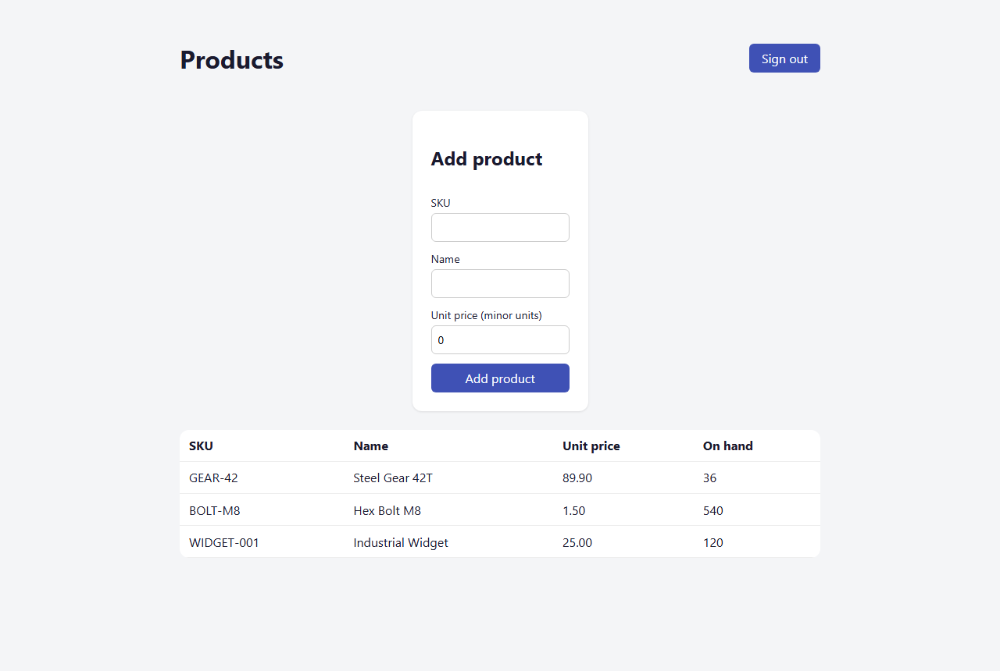
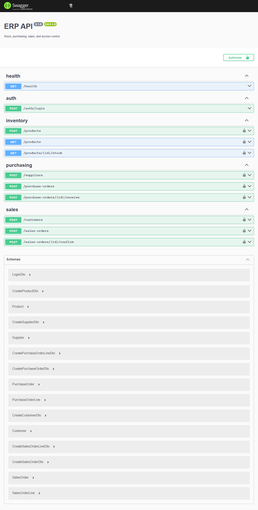
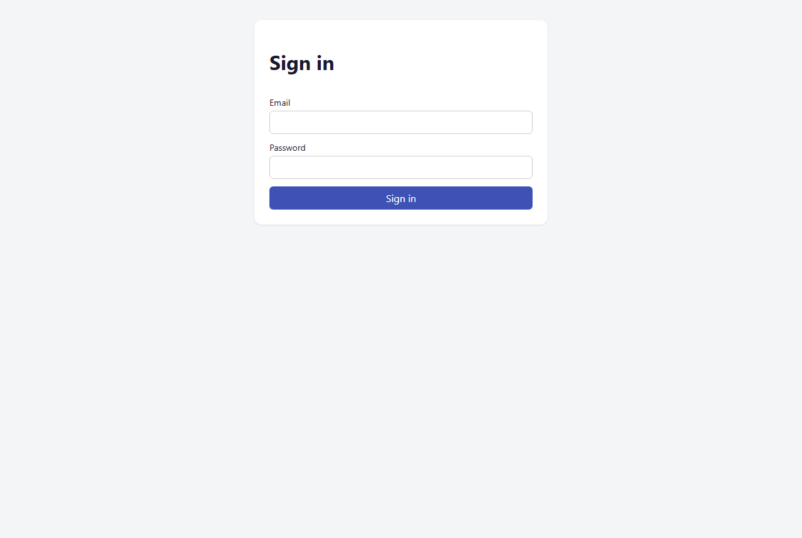

# ERP — Full-Stack Enterprise Example

A compact but production-shaped ERP: stock, purchasing, sales, business rules, atomic
transactions, and role-based access control. Built as a **modular monolith** with a clear domain
model, a full testing pyramid, and a professional CI pipeline.

> Portfolio project. It is **not** hosted — the pipeline builds and tests everything and produces a
> runnable Docker image, but there is no deployment target by design.

## Screenshots

**Products dashboard** — live stock on hand, derived from the append-only ledger, with prices
formatted from integer minor units by the shared `Money` value object:



**OpenAPI / Swagger** — every endpoint grouped by bounded context, with a lock on the
permission-guarded routes:



**Sign in** — stateless JWT authentication, passwords hashed with Argon2id:



## Stack

| Layer    | Technology                                                                     |
| -------- | ------------------------------------------------------------------------------ |
| Frontend | React 19, TypeScript, TanStack Query, React Router, Vite                       |
| Backend  | NestJS 11, TypeScript, TypeORM                                                 |
| Database | PostgreSQL 16                                                                  |
| Auth     | JWT + Argon2id, role-based permissions (`resource:action`)                     |
| API docs | OpenAPI / Swagger                                                              |
| Testing  | Jest (unit), Jest + Supertest + Testcontainers (integration), Playwright (E2E) |
| Quality  | ESLint, Prettier, CodeQL, Dependabot                                           |
| Tooling  | pnpm workspaces, Docker + Docker Compose, GitHub Actions                       |

## What it does

- **Inventory** — products and an append-only stock ledger; current stock is always derived, never overwritten.
- **Purchasing** — suppliers and purchase orders; receiving an order raises stock atomically.
- **Sales** — customers and sales orders; confirming an order lowers stock atomically and can never oversell.
- **Business rules** — e.g. a sale cannot drive stock negative; only a draft order with lines can be confirmed.
- **Transactions** — multi-table commands commit or roll back as one unit (TypeORM transactions).
- **Roles & permissions** — every state-changing endpoint is guarded by a required permission.

## Architecture

A single NestJS application split into bounded-context modules (`inventory`, `purchasing`, `sales`,
`iam`). The design is documented, not implied:

- Domain language: [`CONTEXT-MAP.md`](./CONTEXT-MAP.md) and each module's `CONTEXT.md`.
- Decisions and trade-offs: [`docs/adr/`](./docs/adr).
- Module shapes, seams, and the test strategy: [`docs/DESIGN.md`](./docs/DESIGN.md).

Two deliberate choices worth calling out: stock is an **append-only ledger** (`QuantityOnHand` is a
sum, giving a full audit trail), and money is stored as **integer minor units** (never floats).

### How a sale is confirmed

Confirming a sales order is the flow that ties the system together, and it shows the enterprise
concerns working in one request:

1. The `PermissionsGuard` checks the caller holds `sales_order:confirm` (evaluated by the pure `AccessPolicy`); otherwise **403**.
2. Inside a single database transaction (`TransactionRunner`), the order is validated as a confirmable draft, and the `StockLedger` writes one outbound movement per line.
3. If any line would drive stock below zero, the ledger throws, the **whole transaction rolls back**, and the client gets **409** — no partial order, no phantom stock movement.
4. On success the order flips to `confirmed` and the stock movements commit atomically with it.

This single path exercises authorization, business rules, and ACID transactions together — and it
is covered end-to-end by the integration tests.

## Repository layout

```
apps/
  api/            NestJS API (modules: inventory, purchasing, sales, iam)
  web/            React client (container/presentational, TanStack Query)
packages/
  shared/         Framework-agnostic domain values (Money, Quantity), built dual ESM + CJS
docs/             ADRs and the design document
.github/          CI, CodeQL, Dependabot
```

## Running it locally

Prerequisites: **Node 24+**, **pnpm 10+**, **Docker**.

```bash
pnpm install
```

### 1. Start the backend (API + PostgreSQL)

```bash
docker compose up --build       # builds the API image and starts it with Postgres
pnpm --filter @erp/api seed      # load roles and demo users
```

- API: <http://localhost:3000>
- Interactive API docs (Swagger): <http://localhost:3000/docs>
- Health check: <http://localhost:3000/health>

> Ports 3000 or 5432 already taken? Override them:
> `API_HOST_PORT=3100 DB_HOST_PORT=5433 docker compose up --build`.

### 2. Start the frontend

```bash
pnpm --filter @erp/web dev       # http://localhost:5173, proxies /api to the backend
```

Then sign in with a seeded account:

| Email                 | Password        | Role                                       |
| --------------------- | --------------- | ------------------------------------------ |
| `admin@erp.local`     | `Admin123!`     | admin — every permission                   |
| `warehouse@erp.local` | `Warehouse123!` | warehouse_operator — products & purchasing |
| `sales@erp.local`     | `Sales123!`     | sales_clerk — customers & sales            |

## Testing

A full pyramid, each layer testing through its real seam:

```bash
pnpm -r test            # unit: domain values, order rules, access policy
pnpm test:integration   # integration: HTTP + real PostgreSQL via Testcontainers
pnpm --filter @erp/web test:e2e   # E2E: Playwright against a running, seeded stack
```

Integration tests spin up a disposable PostgreSQL container and exercise the real confirm-sale
flow, including transaction rollback on oversell and a 403 from the RBAC guard.

## Quality & CI

GitHub Actions runs lint, type-checking, the unit/integration/E2E suites, a CodeQL scan, and a
Docker image build on every push and pull request. Dependabot keeps npm, GitHub Actions, and the
base image up to date. See [`.github/workflows`](./.github/workflows).
